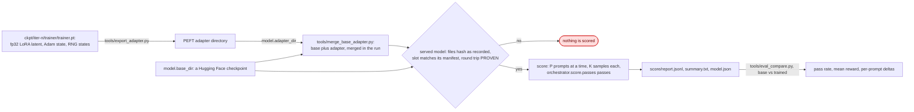
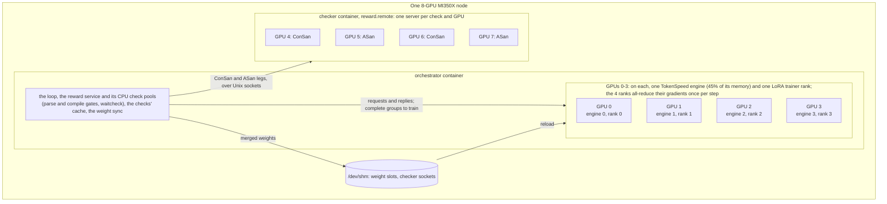

# AORLTA

AORLTA is a minimal GRPO training loop that uses TokenSpeed as its inference engine, built for GPU-kernel repair.
The model is shown a kernel, answers with a fixed one, and gets the compiler's errors back for up to two repair
turns; the final answer is scored by staged checks. One 8-GPU MI350X (gfx950) node runs all of it: 4 TokenSpeed
engines generate, a reward service runs the checks (a compile gate, waitcheck, ConSan, ASan) behind a cache, with
worker pools and a watchdog, 4 LoRA trainer ranks beside the engines train each group as soon as it is scored, and
the new weights are loaded into every engine after each step. Every step is checked: trainer and engine must agree
on the log-probs of the sampled tokens, each weight update must be seen to land on every engine, and an iteration
trains only if enough of its samples were scored, where an unscored sample never counts as clean. A score run
(`orchestrator.mode: score`) uses the same rollouts and checks to score a model without training it.

This directory is a self-contained Python package, `aorlta`, inside the aorta repository; aorta's own package does not
import it, and the stand-in checks use aorta's sanitizer backends from a separate checkout. It is the framework, not
a model: so far it has run only on stand-ins, the public Qwen3.5-4B, our own prompts and our own cheap checks.

New to it? [docs/GETTING-STARTED.md](docs/GETTING-STARTED.md) is the order to do things in: what you need, the CPU
tests, the first GPU run, reading the outputs, the settings, and what the job's exit codes mean.

## How it works

One training iteration, as `orchestrator/loop.py` runs it (the numbers are its steps). The rollout chain is
`rollout/chain.py`, the checks `reward/service.py` with the stages of the run's profile, the trainer `trainer/`, the
weight sync `sync/`. Every red box stops the run; the reason is in `run_result.json`.

```mermaid
%%{init: {"flowchart": {"wrappingWidth": 400}}}%%
flowchart TD
    subgraph setup["Start of a run, once"]
        plan["run plan: the resolved config, the code commit, file hashes"] --> estart["engines start: settings read back,<br/>sampling self-test (different seeds must differ)"]
        estart --> rt["round trip: a perturbation must change every probe's log-probs,<br/>restoring the base must bring them back bit for bit"]
        rt --> warm["trainer warm-up; on resume, the checkpoint is restored and must land"]
    end
    warm --> select

    select["1 select P prompts from the pool: seeded, resume-safe"] --> turn
    subgraph rollout["2-3 generate: TokenSpeed engines at policy v(n-1), K chains per prompt"]
        turn["one request per chain and turn, with its own seed"] --> parse{"parse the reply<br/>rollout.parse_adapter"}
        parse -- "an answer" --> compile{"compile check<br/>rollout.compile_adapter (none: skipped)"}
        parse -- "rejected with a reason (the parser sets rejection), a turn left" --> feedback["repair turn<br/>rollout.feedback_template"]
        compile -- "errors, a turn left" --> feedback
        feedback --> turn
        parse -- "no change; rejected on the last turn;<br/>rejected with no reason (standin.parse: no code block)" --> cand
        compile -- "compiled, or errors on the last turn" --> cand["the chain ends: its final answer is a candidate"]
    end
    cand -- "handed over as each chain ends" --> stages
    subgraph reward["reward service: staged checks behind a cache, reward.profile"]
        stages["stages run in order while the reward function needs more:<br/>parse gate, compile gate, waitcheck, ConSan, ASan in the stand-in profiles;<br/>a task's own profile names only its own checks"] --> rfn["reward function, reward.reward_fn:<br/>a reward in -1.55..1.0, or unscored (an unsettled check is never clean)"]
    end
    rfn --> group["4 a group whose K results are final: GRPO advantages within it,<br/>its gradient accumulated at once (streaming)"]
    group --> barrier["5 generation barrier: engines idle; 6 wait for scoring, to its deadline"]
    barrier --> frac{"7 scored fraction at least<br/>orchestrator.min_scored_fraction?"}
    frac -- "no, after re-checking unsettled legs once" --> stopped(["stop: the iteration is not trained"])
    frac -- "yes" --> gap
    subgraph trainer["8 LoRA trainer ranks, GRPO"]
        gap{"gap gate: trainer vs engine log-probs of the sampled tokens,<br/>per sample, against trainer.max_generation_gap"} -- "over the limit: left out" --> offp{"more than<br/>max_off_policy_fraction left out?"}
        gap -- "within the limit" --> opt
        offp -- "no" --> opt["one optimizer step, then the step checks:<br/>finite, non-zero gradient; LoRA moved; frozen weights did not; ranks agree"]
    end
    offp -- "yes" --> stopped2(["stop: nothing is published"])
    opt -- "a check fails" --> stopped2
    opt -- "checks pass" --> merge
    subgraph sync["9 weight sync"]
        merge["merge the LoRA into bf16 weights"] --> slot["write a weight slot in sync.dir (/dev/shm by default)"]
        slot --> reload["reload every engine (none may hold a request)"]
        reload --> land{"landing check on every engine:<br/>probe log-probs changed, and agree with the trainer's"}
    end
    land -- "NOT_LANDED or MISMATCH" --> stopped3(["stop: the weights did not land"])
    land -- "LANDED, or NOOP (5 in a row stop)" --> record["10 record: episodes, summary, TensorBoard,<br/>checkpoint ckpt/iter-n; the iteration directory's rename commits it"]
    record -- "next iteration: the engines hold v(n)" --> select

    classDef stop fill:#fdd,stroke:#c00,color:#600
    class stopped,stopped2,stopped3 stop
```



A score run (`orchestrator.mode: score`, `orchestrator/score.py`) serves a model, checks it is exactly the one the
run plan hashed, and runs the same rollouts and checks over the pool, with no trainer and no weight sync; an unscored
sample is still never clean. A trained checkpoint holds a LoRA latent; to score it, export it as a PEFT adapter with
`tools/export_adapter.py`, which [#612](https://github.com/ROCm/aorta/pull/612) adds (`tools/eval_compare.py` comes
with the worked examples, [#613](https://github.com/ROCm/aorta/pull/613)):



Where it runs, in `configs/standin.yaml` (the worked examples' one-GPU configs put one engine and one rank on GPU 0,
and run their checks on the CPU):



## Status

What is verified, with the commands to reproduce it, and what is not yet shown: [VALIDATION.md](VALIDATION.md).

On stand-ins the loop runs end to end on one node. The last stand-in training run (`configs/standin.yaml`'s settings,
3 iterations of 16 prompts × 16 samples) trained every iteration, landed every weight update on all 4 engines, and
passed the gap check every step. From its iteration summaries (the command is under "Run outputs"):

| iteration | scored of 256 | wall s per 256 scored | gap p99 (limit 0.05) | samples over the limit | landing |
|---|---|---|---|---|---|
| 1 | 206 | 319 | 0.016 | 0 | LANDED on 4 of 4 |
| 2 | 218 | 303 | 0.017 | 0 | LANDED on 4 of 4 |
| 3 | 192 | 265 | 0.017 | 0 | LANDED on 4 of 4 |

The gap is a sample's mean |trainer − engine| log-prob over its reply, in nats; p99 is over the step's samples. The
run took 17 min 39 s, setup included. Mean reward was −0.91, −0.95 and −0.89 under `standin.v11`: stand-in rewards,
not a result. A SIGKILL drill in an earlier run resumed from the last checkpoint and finished.

Not there yet:

- No trained model worth sharing: only 3-iteration stand-in runs. The stand-in prompts show a kernel's original
  disassembly, with no bug planted, and ask for a HIP source, so they exercise the loop, not the task.
- The stand-in checks are cheap, so the times above say little about a run with heavier checks.
- One node layout is wired. A task of your own (prompts, answer parsing, checks and reward) is a plugin, with no
  edit to the package: [docs/ADAPTING.md](docs/ADAPTING.md) has the contract, and [docs/TUTORIAL.md](docs/TUTORIAL.md)
  walks through `examples/hip-kernels/`, a kernel-writing task whose reward runs the kernel and checks its output.

## Layout

| `src/aorlta/` | what it holds |
|---|---|
| `orchestrator/` | the loop (`loop.py`), the score run (`score.py`), prompt selection, checkpoints and resume, deadlines, the scored-fraction rule; `wiring.py` connects the real components, `fakes.py` stands in for them; entry point `run.py` |
| `rollout/` | TokenSpeed engine processes, compile-repair chains, turn templates and the stand-in prompts, the parse and compile checks, compile feedback |
| `reward/` | the reward service (stages, worker pools, watchdog, cache, trusted controls, checker servers in other processes); `adapters/` are the checks, `rewardfn/` the reward function, `profiles/` the stage files |
| `trainer/` | the GRPO loss, packing, one LoRA rank per engine GPU, the per-step checks, the merged-weight forward |
| `sync/` | merge the LoRA into bf16 weights, write a weight slot, reload the engines, the landing check, the start-up round trip |
| `selector/` | a check planner that only logs (it records what it would skip and skips nothing), and its offline evaluator |
| `episodes/` | episode records, the iteration summary, the TensorBoard writer |
| `measure/` | timeline and critical path, time per 256 scored samples, the trainer-engine gap, the share of time spent waiting on checks, compute curves, a comparison report against a baseline run |
| `eval/` | the hook for an external evaluator; not used by runs yet |
| top-level modules | `config.py` (every run-config key, its default and range), `schemas.py` (records passed between components), `ids.py`, `spans.py`, `atomic.py` |

Outside `src/aorlta/`: `configs/standin.yaml` (the stand-in training run: 4 engines, 4 trainer ranks, every check)
and `configs/dev-standin.yaml` (one trainer rank and the CPU checks of `standin-static`, which score only gate,
compile and waitcheck failures, so a candidate that passes them stays unscored); `jobs/aorlta-run.sbatch` (a run),
`jobs/aorlta-reward-standin.sbatch` (a test of the stand-in GPU checks) and two scripts the run job calls; `docker/`
the trainer image; `tests/` the CPU suite; `tools/merge_base_adapter.py`, which merges a PEFT adapter into its base
checkpoint; `examples/standin-pool/`, a synthetic prompt pool; `examples/hip-kernels/` with `configs/hipk-score.yaml`
and `configs/hipk-train.yaml`, the worked example of a task as a plugin; `docs/ADAPTING.md` and `docs/TUTORIAL.md`. Code comments cite sections and
labels (Section 6.x, C1-C9, D7, ...) of our internal design notes, which are not included.

## Requirements

- One node with 8 MI350X GPUs (gfx950), Docker and Slurm. GPUs 0-3 each hold a TokenSpeed engine (45% of the GPU
  memory) and a trainer rank; ConSan runs on GPUs 4 and 6, ASan on 5 and 7. On a node whose GPUs report 252 GiB
  rather than 288, the last stand-in training run left under 1 GiB free per GPU.
- Three images, which the run job builds or pulls: TokenSpeed (github.com/lightseekorg/tokenspeed) at commit
  `3b684074c0ef79bc8bc00b31cda8dc2850e4b71f`, built with TokenSpeed's own `docker/Dockerfile.amd` (base
  `lightseekorg/tokenspeed-runner-amd:rocm7.2.4-pytorch-2.13.0-gfx950`; torch 2.14.0+rocm7.2, Python 3.12); the
  trainer image, `docker/Dockerfile.trainer` on top of it (fla-core 0.6.0, causal-conv1d 1.7.0 built for gfx950,
  peft 0.21.2, accelerate 1.15.0, xxhash 4.0.2, each pinned by hash); and `rocm/dev-ubuntu-24.04:7.0.2` for the
  ConSan and ASan servers (the rocjitsu hook needs glibc 2.38 or later, and the ROCm 7.0.2 ASan runtime, which the
  job mounts from the host, needs ROCm 7.0.2). On a node without the TokenSpeed image the job builds it (about
  12 min) from a source tree of that commit, `TS_SRC`.
- The base model `Qwen/Qwen3.5-4B` at revision `851bf6e806efd8d0a36b00ddf55e13ccb7b8cd0a`, already in the Hugging
  Face cache: the job runs offline. Only the Qwen3.5 family works as it stands (the turn templates use its
  control-token ids, and the trainer its linear-attention fast path).
- A stand-in prompt pool: a kernel dataset in the format of `examples/standin-pool/`, with at least 40 kernels of
  60 to 400 instructions (the landing check picks 40). The dataset the stand-in runs used is not published, and the
  example pool is too small to run on.
- What the stand-in checks call: aorta at `d22f6116235c05395a0241a83d6f7e952a988454` (a commit of this repository),
  for its sanitizer backends and test kernels; rocjitsu's `rj_waitcheck` and `librocjitsu_dbi_hooks.so`, from
  ROCm/rocm-systems branch `shared/rocjitsu/sanitizers`; the ROCm 7.0.2 ASan runtime libraries; a libstdc++ recent
  enough for `rj_waitcheck`; hipcc and llvm-readelf (the compile gate's LDS record needs both).
- A Python 3.12 venv with `requirements-dev.txt` (`AORLTA_VENV`): the job runs this package outside the images too,
  on the host to read the config, and in the checker containers.

The paths a run needs are set here (the checks' defaults are under `/opt`):

| what | where it is set |
|---|---|
| run directory, base model, prompt pool, checker sockets, weight slots | the run config: `run.root`, `model.base_dir`, `data.prompt_pools`, `reward.remote.socket_dir` (under `/dev/shm`), `sync.dir`; or a site file that `AORLTA_SITE` names (below), which sets only these |
| the check tools | environment variables, read when a profile in `src/aorlta/reward/profiles/` is loaded: `AORLTA_ROCM_ROOT` (default `/opt/rocm`: hipcc and llvm-readelf), `AORLTA_ROCJITSU_ROOT` (`/opt/rocjitsu`: `bin/rj_waitcheck`, `lib/librocjitsu_dbi_hooks.so`), `AORLTA_AORTA_ROOT` (`/opt/aorta`: its `src/` and the control kernels), `AORLTA_LIBSTDCXX_SHIM` (`/opt/libstdcxx-shim`) |
| what the run job mounts and runs | environment variables, documented in the header of `jobs/aorlta-run.sbatch`: `AORLTA_VENV`, `TS_SRC`, `AORLTA_ASAN_LIB`, `AORLTA_AORTA_ROOT`, `AORLTA_ROCJITSU_ROOT`, `AORLTA_LIBSTDCXX_SHIM`, `AORLTA_SITE`, `AORLTA_HF_HOME`, `AORLTA_TMPDIR`, `AORLTA_DOCKER_CONFIG`, `AORLTA_MOUNTS`, `AORLTA_EXCLUDE_NODES`. It mounts those directories and passes the check-tool variables into its containers, which use their image's `/opt/rocm` |

Docker mounts each of these directories, and the package root, at its host path, so the docker daemon must be able
to read them, at the same paths as the job: a root-squashed network home will not do, nor a Slurm job's private
`/tmp` (`job_container/tmpfs`). The run job checks the second before it starts the run.

A site file keeps a site's paths out of the committed config. It is YAML with only the keys in the first row, and
`data.prompt_pools` gives one path per pool of the config, in order:

```yaml
run: {root: /scratch/me/aorlta-runs}
model: {base_dir: /data/hf/hub/models--Qwen--Qwen3.5-4B/snapshots/851bf6e806efd8d0a36b00ddf55e13ccb7b8cd0a}
data: {prompt_pools: [/data/aorlta/standin-pool]}
```

## Tests

```bash
cd aorlta                  # from the root of the aorta checkout, in a Python 3.12 venv
pip install --extra-index-url https://download.pytorch.org/whl/cpu -r requirements-dev.txt
pip install -e . --no-deps
export OMP_NUM_THREADS=1 MALLOC_MMAP_THRESHOLD_=65536 MALLOC_ARENA_MAX=2
python -m pytest -q -n 8 -m "not heavy and not cpu_run"
OMP_NUM_THREADS=2 python -m pytest -q -n 2 -m "heavy and not cpu_run"
OMP_NUM_THREADS=4 python -m pytest -q -m cpu_run
```

These are CI's three parts. Keep the worker counts small: `-n auto` on a machine with many cores runs out of memory,
since a worker can grow by about 1.5 GB for each wired test it runs.

Run them in a git checkout: a run records its code commit. Tests that need hipcc, a GPU, the base model's tokenizer
(read from `HF_HOME`), a full stand-in dataset (`AORLTA_STANDIN_DATASET`), aorta's fixtures or the checker tools skip
and say what is missing.
CI runs the same commands on every pull request that changes `aorlta/` (`pytest (AORLTA, py3.12)` in
`.github/workflows/cpu-tests.yml`).

## The loop on CPU, with fake components

`--components fake` runs the real loop with fake engines, checks, trainer and weight sync, from a run config, in about
a second for 3 iterations. Copy `configs/dev-standin.yaml` with scratch paths (the fakes write placeholder model files
into `model.base_dir`, so do not point it at a real model) and run it:

```bash
export SCRATCH=/path/to/scratch   # any absolute path
python -c 'import os, yaml; s = os.environ["SCRATCH"]; c = yaml.safe_load(open("configs/dev-standin.yaml"))
c["run"]["root"], c["model"]["base_dir"], c["data"]["prompt_pools"][0]["path"] = f"{s}/runs", f"{s}/base", f"{s}/pool"
yaml.safe_dump(c, open(f"{s}/dev.yaml", "w"), sort_keys=False)'
python -m aorlta.orchestrator.run --config "$SCRATCH/dev.yaml" --components fake
```

It prints `{"status": "completed", "iterations_completed": 3, ...}` and writes a run directory (see "Run outputs")
under `$SCRATCH/runs/standin/`. The fakes bring their own prompts and checks: this checks the config and the loop,
not the prompt pool or the checks the config names.

## A stand-in run on GPUs

One Slurm job runs everything. Put the site paths in a site file (or edit them in `configs/standin.yaml` and commit
it), and submit from `aorlta/` with the job's environment variables set (see "Requirements"; `AORLTA_ASAN_LIB` has no
default):

```bash
mkdir -p runs
export AORLTA_SITE=/path/to/site.yaml AORLTA_ASAN_LIB=/path/to/rocm-7.0.2-asan/lib/asan TS_SRC=/path/to/tokenspeed-3b684074
CONFIG=configs/standin.yaml sbatch jobs/aorlta-run.sbatch
```

1. The job runs from a snapshot of the committed tree in `runs/<job id>/code`, so the config must be committed; it
   keeps a copy of the site file there too.
2. It runs aorta's ASan node-health canary on the checker GPUs, starts one checker server per check and GPU, and
   runs them on aorta's test kernels; if either fails, it stops before building anything.
3. It builds the images it needs, checks that the run's modules import inside them, and starts the orchestrator.
4. It writes its logs to `runs/<job id>/` and the run to `<run.root>/standin/<run.run_id>/`; at the end it removes
   its containers, its `/dev/shm` files and the images it built or pulled.

Options: `RESUME=1` resumes the run from its last checkpoint; `KILL_AFTER_ITER=n` is the kill-and-resume drill;
`SMOKE=checkers` runs only the canary and the checkers on aorta's kernels, a smoke test of the checkers; `SMOKE=skip`
skips that test; `COMPONENTS=fake` runs the loop with its fakes. To keep the job off some nodes, set
`AORLTA_EXCLUDE_NODES` and give `sbatch --exclude` the same list. The job exits 0 when the run completed and 3 when
it stopped; the reason is in `run_result.json`. A run id is used once: the orchestrator refuses a run directory that
already exists, so for a new run copy the config, give it a new `run.run_id`, and commit it.

## Score a model without training

`orchestrator.mode: score` runs the same rollouts and checks over the prompt pool with no trainer step, no optimizer
and no weight sync; the same job script runs it (`CONFIG=configs/score-standin.yaml sbatch jobs/aorlta-run.sbatch`).
The run:

1. writes its run plan, with the sha256 of every file of `model.base_dir` (and of `model.adapter_dir`);
2. serves `model.base_dir` as it is, a merged Hugging Face directory, or, with `model.adapter_dir` (a PEFT LoRA
   adapter trained on that base), first merges the two with `tools/merge_base_adapter.py` into
   `<sync.dir>/<run_id>/model`, and refuses a merge of other inputs than the files the plan hashed, or a base whose
   index names a shard below its top level;
3. checks that the engines serve exactly that directory before anything is scored: its files must hash as recorded,
   all its tensors are written to a weight slot whose manifest must match the slot's files, and the start-up round
   trip must be PROVEN;
4. scores the first `orchestrator.score.prompts` prompts of the pool in `orchestrator.run_seed`'s order (null: all),
   `rollout.P` at a time, `rollout.K` samples each, once per `orchestrator.score.passes`, each pass with its own
   seeds. The unsettled checks are re-checked once. The scored fraction does not stop a score run, but an unscored
   sample is never counted clean.

It writes the episodes as a training run does (`trained` false, `excluded_reason` `score_only`), plus
`score/report.jsonl` (the model's hashes, the landing check, the sampling settings, one row per prompt and one for
the totals: samples, scored, unscored and clean counts, the reward over scored samples, each check's counts, compile
success and repair turns), `score/summary.txt`, the same in a few lines, and `score/model.json`, the landing check
in full. `configs/score-standin.yaml` scores the public Qwen3.5-4B on 16 stand-in prompts × 4 samples, on the
stand-in layout without trainer ranks. A score run is never resumed: run it again under a new run id. On CPU, the
same config runs with the fakes, as under "The loop on CPU, with fake components".

## Correctness checks

| check | when | what it refuses |
|---|---|---|
| config | load | an unknown or duplicate key, a wrong type, a value out of range, or a reward function the profile does not name |
| run plan | start | a run id that already has a directory |
| engine start | start | an engine whose settings read back wrong (sampler, log-probs, prefix cache, dtype), or whose self-test gives the same sample for different seeds or misaligned log-probs |
| round trip | start | weights that do not reach the engines: a synthetic perturbation must change every probe's log-probs, and restoring the base must bring them back bit for bit |
| sampling | each iteration | more than 5% of groups whose K answers are all identical |
| unscored is never clean | each check | an adapter error, a timeout, a lost worker or a check with nothing to watch leaves the check unsettled, and the sample unscored unless a finding is confirmed; a clean reward needs every check of the profile clean |
| minimum scored fraction | after scoring | training on an iteration with fewer than `orchestrator.min_scored_fraction` of the candidates handed to the reward service scored (0.9 by default, 0.75 in `standin.yaml`): the unsettled checks are retried once, then the run stops |
| gap check | each step | a sample whose trainer and engine log-probs differ by more than `trainer.max_generation_gap` (0.05 nats of mean \|Δ\| in `standin.yaml`) is left out of the step; if more than `max_off_policy_fraction` (2%) are left out, the step is refused and the run stops |
| step checks | each step | a non-finite or zero gradient, a non-finite loss, or a group trained twice; after the step, a LoRA tensor that is non-finite or did not move, a frozen weight that moved, or ranks that disagree. The run stops before the weights are published |
| landing check | each weight sync | an engine whose probe log-probs did not change after a real update (NOT_LANDED), or differ from the trainer's by more than a limit calibrated at start (MISMATCH): the run stops. Five updates in a row that change nothing on the engines (NOOP) stop it too |
| generation barrier | each weight sync | a reload while an engine still holds a request |
| served model | start of a score run | a model directory whose files no longer hash as recorded or whose index names a shard below its top level, a merge of other inputs than the run plan's, a slot that does not match its manifest, or a round trip that is not PROVEN: nothing is scored |
| resume | resume | a run another process still holds (`run.lock`), a ledger with a bad line before its end, a checkpoint whose files do not match its manifest, a trainer state that does not match the saved digest, or a changed prompt pool |

## Run outputs

The run directory is `<run.root>/<run.source>/<run.run_id>/`; `<n>` is the iteration, in six digits:

| path | what |
|---|---|
| `run_plan.json` | the resolved config, the code commit and file hashes; written first |
| `run_result.json` | `completed` or `stopped`, the stop reason, one entry per attempt |
| `run.lock` | locked by the one process running or resuming the run, while it does |
| `iterations/iter-<n>/` | a committed iteration: `episodes.jsonl`, `summary.json`, `spans.jsonl`, `cursor.json` |
| `ckpt/iter-<n>/` | `trainer/trainer.pt` (the fp32 LoRA latent, Adam state, RNG states), `state.json`, `MANIFEST.json`; the last 2 are kept |
| `tb/` | one TensorBoard event file per iteration, scalars only (52 in the last stand-in training run) |
| `trainer/gaps-<n>.jsonl` | each sample's trainer-engine gap |
| `reward/cache/`, `selector/plan_log.jsonl` | the check cache, and what the planner would have skipped |
| `evidence/` | compiler stderr and the GPU checks' logs (owner-only) |
| `score/` | a score run's `report.jsonl`, `summary.txt` and `model.json` |

`episodes.jsonl` has one line per chain (`aorlta.episode/1`): each turn's token ids, engine log-probs, compile
result and timings, then the end reason, reward, status, each check's state, the advantage and whether it trained.
It holds ids, hashes and numbers, no text: decode `response_ids` with the model's tokenizer to read an answer.
`summary.json` has the iteration's counts, timings, trainer checks and gap, and landing verdicts. This prints the
table under "Status" and the mean reward from a run directory:

```bash
python -c 'import sys; from aorlta.episodes.writer import complete_iterations, read_summary
for n in complete_iterations(sys.argv[1]):
    s = read_summary(sys.argv[1], n); t = s["trainer"]
    print(n, s["samples"]["scored"], round(s["timing"]["per_256_scored_s"]), (t["gap"] or {}).get("p99"),
          (t["gap_gate"] or {}).get("over_bound"), s["sync"]["verdicts"], s["reward"]["mean"])' RUN_DIR
```

TensorBoard reads `tb/` (checked with 2.21; it is not a dependency). The checkpoint is a plain `torch.save` dict:
`torch.load(path, map_location="cpu", weights_only=True)["lora"]` gives the 496 fp32 LoRA tensors (r 16, alpha 32),
named `<module>.lora_A` and `<module>.lora_B`. The engines' weight slots are in `/dev/shm` and are removed when the
run ends. To use a trained LoRA elsewhere, export a checkpoint as a PEFT adapter directory, then score it, merge it,
or load it with peft:

```bash
python tools/export_adapter.py --ckpt RUN_DIR/ckpt/iter-000003 --out /path/to/adapter
# score it: model.adapter_dir: /path/to/adapter in a score run's config, on the run's base
python tools/merge_base_adapter.py merge --base BASE_DIR --adapter /path/to/adapter --out /path/to/merged
```

The export checks the checkpoint against its manifest and reads its output back bit for bit; merged with
`merge_base_adapter.py`, it gives exactly the weights the engines served at that iteration, unless the run used
`sync.stochastic_rounding`.

## Getting help

Open an issue on this repository with the **AORLTA problem or question** template (label `aorlta`): what you ran,
the commit, the model, the GPUs, the full command and the end of the log. Vivek Khandelwal (@vivekkhandelwal1)
maintains AORLTA and reads them. Feedback on these docs is as welcome as a bug report: open an issue titled
`docs: ...` for anything that was unclear, wrong or missing.

## Known limits

- No eval exporter (`orchestrator.eval_every` must stay null), so no evaluation during a run.
- Past the generation deadline no chain starts another turn, but a running request is not aborted; it ends at
  `rollout.request_timeout_s`. An engine that dies is restarted out of service, so the next iteration stops.
- Under `standin.v11` a candidate whose kernels give ConSan nothing to watch (no LDS, barrier, atomic or fence) stays
  unscored. In the last stand-in training run 152 of 768 samples stayed unscored, all with `sanitizer_not_settled`;
  that is why `standin.yaml` sets the scored fraction to 0.75, which iteration 3 met exactly (192 of 256).
- A hung candidate kernel costs its ASan check the full 45 s limit (ConSan's limit is 30 s in `standin.yaml`).
- Score runs: an adapter's merge (and so a scored export of a trained checkpoint) has run only in the CPU tests, `rollout.K` must be at least 2, and a pass whose groups
  give K identical answers too often stops, as a training iteration does.
