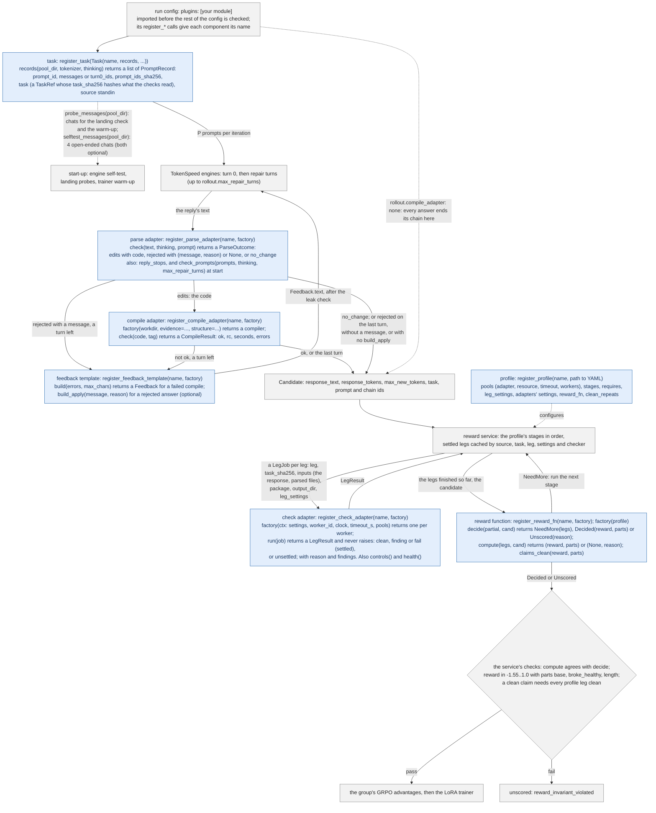

# Adapting AORLTA: your own prompts, reward and checks

Code paths are relative to `src/aorlta/`; commands and the `configs/`, `examples/` and `tests/` paths are relative to
`aorlta/`, and the commands assume the environment from the README.

## Pick your vertical: a checklist

1. **The task in one sentence.** What does the model get, and what must it produce?
2. **Is it automatically checkable?** A program must score every answer with no human in the loop: a compiler and
   a reference run, a reference answer (exact or normalised match, or a judge command), or another tool's verdict.
   If the check cannot always decide, it must say so: an answer it cannot settle is unscored, and **an unscored
   sample is never counted clean**. Too many unscored samples stop a training iteration
   (`orchestrator.min_scored_fraction`).
3. **Where the prompts come from,** and a held-out set kept out of training to evaluate on. Training takes
   `rollout.P` prompts per iteration, so have many more than `P`.
4. **Single-turn or a repair loop?** The episode is the model's answer, then up to `rollout.max_repair_turns` turns
   of feedback: compiler errors, or a message your parse gives a rejected answer. Anything else (tool calls, an
   environment the model acts in) is not supported yet.
5. **The reward.** Give each failure you can name its own value, so the answers to one prompt get different rewards
   (GRPO learns only from those differences); keep it in [-1.55, 1.0] with the parts `base`, `broke_healthy` and
   `length`. If the base model already gets nearly everything right, or nothing, there is nothing to learn: score
   it first.
6. **The compute budget.** One node; see "How many GPUs" in GETTING-STARTED.md. A short check (a string match) costs
   nothing; a GPU run of every answer needs GPUs of its own and its own time limit.
7. **Score the base model** on the held-out set (`orchestrator.mode: score`), **train**, then **score the trained
   adapter** on the same set and compare.
8. **Write your two-line summary:** what the model is post-trained on, and how its answers are checked.

## Your own task, as a plugin

A task of your own (its prompts, how an answer is read, its repair turns, its checks and its reward) does not need
an edit to the package. Write a Python module that registers its components with `aorlta.plugins`, and list it in
the run config:

```yaml
plugins: [examples/my-task/my_task.py]   # a .py path (relative: from aorlta/), or an importable module name
data:
  prompt_pools:
    - {path: /data/my-task, source: standin, task: my-task}
rollout:
  parse_adapter: my-task.parse            # or the built-in standin.parse
  feedback_template: my-task.feedback     # or the built-in standin
  compile_adapter: standin.hipcc          # or one of yours
reward:
  profile: my-task-profile
  reward_fn: my-task.v1
```

The module is imported before the rest of the config is checked, so every name above may be one it registered:

| config key | register with | what it is |
|---|---|---|
| `data.prompt_pools[i].task` | `register_task(Task(name, records, probe_messages=None))` | `records(pool_dir, tokenizer, thinking)` returns the pool's `PromptRecord`s ("A new prompt source" below) |
| `rollout.parse_adapter` | `register_parse_adapter(name, factory)` | a `ParseAdapter` (`rollout/chain.py`) |
| `rollout.feedback_template` | `register_feedback_template(name, factory)` | a `FeedbackTemplate`, optionally with `build_apply` |
| `rollout.compile_adapter` | `register_compile_adapter(name, factory)` | `factory(workdir, evidence=..., structure=...)` returns a compiler |
| `reward.profile` | `register_profile(name, path)` | a profile YAML file ("Checks and profiles" below) |
| `reward.reward_fn` | `register_reward_fn(name, factory)` | `factory(profile)` returns a `RewardFn` ("Your own reward function") |
| a profile pool's `adapter` | `register_check_adapter(name, factory)` | `factory(ctx)` returns a `CheckAdapter` for one worker; `ctx` (`plugins.CheckContext`) holds its profile settings, worker id, clock, timeout and the run's pool paths |

Where each one hooks into a run, and what it receives and returns. Blue boxes are yours; grey boxes are the
framework, which calls them:



A built-in component may be mixed in by name (`standin.parse`, `standin.hipcc` and `standin` are the stand-in
parse, compile and feedback). Nothing in a profile is required: a task whose answers are not code sets
`rollout.compile_adapter: none` (every parsed answer ends its chain) and gives its profile only its own checks, with
no compile gate and no sanitizer. Three shapes, each tested from a package outside `aorlta/`
(`tests/test_plugins_out_of_tree.py`):

| shape | rollout | the profile's legs |
|---|---|---|
| code, rewarded by compiling and matching a reference | a compile check (`standin.hipcc`) and its repair turns | the parse and compile gates, then your reference check (`examples/hip-kernels/`) |
| a question with a reference answer | `compile_adapter: none`; your parse may give a reply with no answer a repair turn | one leg comparing the answer, exactly or normalised, with an optional judge command (`examples/qa/`) |
| a verdict from an external tool or service | `compile_adapter: none` | one leg that calls the tool and reads its verdict; no verdict is unsettled |

### Keeping your task in your own package

The recommended route for a task that is private or not yet released: keep its module, prompts, profile and checks
in a package of your own, outside this repository, and declare an entry point:

```toml
# your package's pyproject.toml
[project.entry-points."aorlta.plugins"]
my-task = "my_package.aorlta_plugin"
```

`plugins: [my-task]` then loads it wherever the package is installed (`pip install` into your venv, or your own
image). The run job's containers run the image's Python, which does not see your venv, so for the job name the
module instead, `plugins: [my_package.aorlta_plugin]`, and put the package on the containers' import path and mount
it: `AORLTA_PYTHONPATH=/path/to/my-package/src AORLTA_MOUNTS=/path/to/my-package`. Either way nothing is copied into
this repository, and the run plan records the plugin file's sha256.
 A component's `name` must be the name it is registered under. The landing check and
the trainer's warm-up read `sync.probes` chats: the task's `probe_messages(pool_dir)`, or the first records' own
messages, which must then share one system message. Each engine's start-up self-test samples 4 chats twice with
different seeds and needs at least 3 of the 4 pairs to differ, so for a plugin task it uses fixed open-ended chats
(`SELF_TEST_CHATS` in `orchestrator/wiring.py`), not the task's own prompts, whose answers may be near-unique;
`Task(selftest_messages=...)` gives others. For the same reason, a task with near-unique answers and few prompts may
need `rollout.identical_groups_stop` raised: by default an iteration stops when more than 5% of its groups have all
`K` answers identical, and with 8 prompts one such group is 12.5%. The run plan records each plugin's file and its sha256.

Limits of a plugin: its data is handled as the stand-in source's (public; text may appear in logs and tracebacks);
its reward stays within the stand-in range and parts (below); the episode is the compile-repair chain (a parse may
reject an answer with a message, and the feedback template's `build_apply` turns that into a repair turn); and
`reward.remote` and the run job's checker pre-flight serve only the stand-in sanitizers, so a plugin's GPU check
runs in the orchestrator's process, on GPUs its own settings name. A plugin file under `aorlta/` is in the run
job's snapshot of the committed tree; one elsewhere must be in a directory the job mounts (`AORLTA_MOUNTS`) and is
then not part of the snapshot. `tests/test_plugins.py` and `tests/orchestrator/test_plugin_wired.py` hold a small
plugin that registers one of each and trains on CPU through the real wiring.

## Prompts in the stand-in format

The stand-in source reads one dataset directory:

- `kernels.json`: a map from kernel id to an entry. The loader reads `kid`, `n_insns`, `heldout`, `demangled`,
  `family` and `library`, and ignores the other keys.
- `listings/<kid>.json`: the kernel's gfx950 disassembly, a JSON list of `[offset, "instruction"]` pairs.

`examples/standin-pool/` is a synthetic example of the format: three small kernels written for it, one held out.

The training pool is every kernel with 60 to 400 instructions (`n_insns`) whose `heldout` is `false`, sorted by
`kid`; its prompt id is `standin:<kid>`. The prompt is a fixed system line and a user turn that names the kernel and
asks for a corrected HIP source in one fenced `cpp` block, with the listing as `0x0000: <instruction>` lines
(`STANDIN_SYSTEM` and `STANDIN_USER0` in `rollout/templates.py`). The sha256 of the listing file is the prompt's task
hash, part of every check's cache key.

The run config names the pool in `data.prompt_pools`, by the absolute path of the dataset directory or of its
`listings/` directory, with `source: standin`; `run.source`, `model.source` and every pool's `source` must agree. A
run needs at least `rollout.P` training kernels (each iteration takes P different prompts; the order is a seeded
shuffle per pass over the pool). The landing probes and the start-up warm-up also come from this dataset: 4 kernels
picked from those with 60 to 400 instructions, held-out ones included, and the picking needs at least 40 of them, so
the example is too small for a run. `standin_training_kernels(dataset)` in `rollout/templates.py` lists the training
kernels a dataset gives, on CPU; for the example they are `example_block_sum` and `example_vector_add`.

## A new prompt source

The loop reads prompts through one method (`PromptPool` in `orchestrator/ports.py`): an object with
`source = "standin"` and `records()`, which returns a list of `PromptRecord` (`schemas.py`):

| field | what |
|---|---|
| `prompt_id` | unique in the pool |
| `messages` or `turn0_ids` | the system and user messages, rendered with the model's chat template, or the exact turn-0 token ids |
| `prompt_ids_sha256` | sha256 of the turn-0 ids: `ids.sha256_ids(rollout.templates.render_turn0(tokenizer, messages, thinking))`; the rollout checks it before sending |
| `task` | a `TaskRef`: `contract_id`, `task_sha256` (a hash of what the checks read; part of the cache key), and `parent_id`, `parent_healthy` and `reference_kind`, which only `standin.v11`'s broke-healthy and frozen-reference terms read |
| `source` | `"standin"`; it must equal `run.source` |

`standin_records` in `rollout/templates.py` builds these for the stand-in pool. A new set of prompts is a task a
plugin registers ("Your own task, as a plugin" above): the pool's `task` names it, and its `records` builds them.
What the wiring still assumes:

- `check_supported` accepts exactly one pool, with `source: standin`;
- a `standin` pool also gives the landing probes and the warm-up, from 40 of its kernels, so it needs at least 40
  kernels of 60 to 400 instructions; a plugin task gives its own probes;
- the answer is parsed by `rollout.parse_adapter`. `standin.parse` takes the last fenced `cpp` block of the final
  turn, and so does the reward's parse gate (`reward/adapters/standin_parse.py`); the compile checks run
  `hipcc --offload-arch=gfx950 -c -O1` on it.

Another answer format is a parse adapter and a feedback template (`ParseAdapter` and `FeedbackTemplate` in
`rollout/chain.py`), registered by a plugin and named by `rollout.parse_adapter` and `rollout.feedback_template`. A parse returns `edits` (the code to compile), `rejected`, or `no_change`: a reply that
leaves the kernel as shown ends the chain without a compile, end reason `no_change` (the stand-in parse never returns
it). A feedback template builds the compile-feedback turn, and may give a rejected answer a repair turn of its own
(`build_apply`). Repair turns are appended to the token ids (`rollout.repair_turn_ids: append`, the default), or
rebuilt with `rerender`: the whole conversation rendered again with the chat template, the replies re-tokenised from
their text (Qwen3.5's template also drops the earlier turns' think blocks and trims every turn).

A data source other than `standin` (data whose text must stay out of logs) is still a change to the package: a
value of `Source` (`config.py`, `schemas.py`) and `SOURCES`
(`episodes/schema.py`, `eval/hook.py`), with a component-name prefix that `component_source` (`config.py`) maps to
it. `tests/orchestrator/test_wiring_e2e.py` builds the real loop on CPU with its own 7-kernel dataset, a tiny model
and in-process engines; it is the template for testing a new source without a GPU.

## Your own reward function

The interface is `RewardFn` in `reward/rewardfn/base.py`:

```python
class RewardFn(Protocol):
    name: str              # e.g. "standin.v11"
    version: str
    code_sha256: str       # hash of its module files, recorded with every reward
    legs: tuple[str, ...]  # every check result it reads, e.g. "gate.compile", "san.asan"
    def decide(self, partial: dict[str, LegResult], cand: Candidate) -> Decided | NeedMore | Unscored: ...
    def compute(self, legs: dict[str, LegResult], cand: Candidate) -> tuple[float | None, dict]: ...
    def claims_clean(self, reward: float | None, parts: dict | None) -> bool: ...
    # optional: not_applicable_legs(legs, cand) -> the legs this record's clean reward does not need
```

- A check of one candidate is a *leg*; its result (`LegResult` in `schemas.py`) has a `state`: `clean`, `finding`
  or `fail` (settled), or `unsettled`, `skipped_by_plan`, `not_run`; plus `reason`, `findings` and `repeats`.
- `decide` gets the legs finished so far. It returns `NeedMore(legs)` while a pending leg could still change the
  answer, and the service runs the next stage. It may return `Decided(reward, parts)` or `Unscored(reason)` only
  when nothing still pending could change the answer, which is how checking stops early.
- `compute` gets the full record: every leg in `legs`, with `not_run` for those that did not run. It returns
  `(reward, parts)`, or `(None, {"reason": ...})` for an unscored sample.

The service does not take the reward on trust. It recomputes it with `compute`, and the result must match
`decide`; the reward must be `None` or a float in [-1.55, 1.0] whose `parts` are exactly `base`, `broke_healthy`
and `length` and add up to it; and a reward that `claims_clean` needs every leg of the profile clean, with enough
repeats, except the legs `not_applicable_legs` names. Anything else is unscored (`reward_invariant_violated`) and
raises an alarm. A reward with another range or other parts needs `_invariant_problems` in `reward/service.py` and
`REWARD_MIN`/`REWARD_MAX` in `config.py` changed with it.

`standin.v11` (`reward/rewardfn/standin_v11.py`) scores all three published profiles. A failed gate scores −1.0
(−0.9 for a compile error), a wrong output −0.7, a crash −0.8 when the trusted controls around it were clean,
sanitizer findings −0.17 to −0.5, and a clean pass +1.0 or +0.5; then −0.5 if a healthy parent broke, and −0.05 ×
the share of the token budget used. An unsettled check leaves the sample unscored unless a finding is confirmed, and
so does ConSan with nothing to watch (NOT_CHECKED: no LDS, barrier, atomic or fence).
`tests/reward/test_standin_v11.py` tests it with Hypothesis, including that `decide` never gives an answer `compute`
would contradict.

A clean `gate.compile` also records the launched kernels' LDS, read from their kernel descriptors: a finding of kind
`trusted_build` (`reward/adapters/standin_hipcc.py`). No published reward function reads it yet; a rule such as
"ConSan does not apply to a launch with no LDS" would read it in `not_applicable_legs`. The gate builds with the run
image's compiler and ConSan with the checker image's, and that the two builds agree on LDS is not checked.

To add a reward function, write the class, register it (`plugins.register_reward_fn(name, factory)`, where
`factory(profile)` builds it), and set `reward_fn:` to its name in your profile, which you register with
`plugins.register_profile`. The config then accepts both names and checks that they agree, and that the profile's
`name:` is the name it is registered under (a candidate carries one and the reward service serves the other).
A profile that names none of the aorta-backed adapters (`standin.rj_waitcheck`, `standin.aorta_consan`, `standin.aorta_asan`)
needs no aorta checkout: the run job's import pre-flight loads aorta's backends only for one that does. To
re-score a run's plan log offline, `python -m aorlta.selector.plan_eval LOG --plugins <your plugin>`.

## Checks and profiles

A profile (`reward/profiles/*.yaml`) says which checks run, where, in what order and after what.
`standin-gpu.yaml`, which `configs/standin.yaml` uses, starts:

```yaml
pools:
  gates: {resource: local_cpu, adapter: standin.parse, timeout: gate, workers: 2}
  compile: {resource: local_cpu, adapter: standin.hipcc, timeout: compile, workers: 4}
  ...
  asan: {resource: own_gpu, adapter: standin.aorta_asan, timeout: asan_request, controls: true, batched: true}
stages:
  - {name: S0, pool: gates, legs: [gate.parse]}
  - {name: S1, pool: compile, legs: [gate.compile]}
  ...
```

- `pools`: a worker pool per check. `timeout` names one of `reward.timeouts` (`gate`, `compile`, `sim_run`,
  `asan_request`). `controls: true` brackets the pool's jobs with trusted control runs; if a control comes back
  dirty, every result since the last clean one becomes unsettled and is retried once on another worker.
  `batched: true` sends up to `reward.asan.max_packages` candidates per request.
- `stages` run in order, each only while the reward function still answers `NeedMore`; a stage's legs run one
  at a time unless it sets `parallel: true` (`speculative` leaves it to `reward.speculative_parallel`).
- `requires`: a leg runs only after these legs are clean; otherwise it is `not_run`.
- `leg_settings` go into the cache key; `adapters` holds each adapter's settings, the tool paths among them,
  written from the tool roots: `${AORLTA_ROCM_ROOT}/bin/hipcc` is the environment variable's value, or its default
  under `/opt` (`TOOL_ROOTS` in `reward/profiles.py`); `materialize: true` writes each candidate's files for
  adapters that read them; `clean_repeats` is how many settled-clean repeats a clean reward needs.

Results are cached by the candidate's source hash, the task hash, the leg, its settings, and the checker's name and
version. Only settled legs are cached. `reward.remote.adapters` in the run config serves an adapter from separate
processes, one per GPU listed; the job starts them with `python -m aorlta.reward.remote serve`. `reward.gpu_check_s`
limits one GPU check of one kernel, in seconds; a check stopped at the limit is unsettled.

To add a check:

1. Write an adapter (`CheckAdapter` in `reward/adapters/base.py`): `name`, `version`, `legs`, `resource`;
   `run(job: LegJob) -> LegResult`, which never raises; `controls()`, the trusted controls it offers; `health()`,
   a quick heartbeat. `make_result` and `unsettled` build results, `ProcessRunner` runs a subprocess the watchdog
   can kill, and the job's files are `job.package`, `job.inputs` and `job.output_dir`. The compile gate,
   `adapters/standin_hipcc.py`, is a short real one.
2. Register a factory with `plugins.register_check_adapter(name, factory)`: `factory(ctx)` builds one adapter per
   worker, from `ctx.settings` (the profile's `adapters:` entry for it). `standin_factories` (`reward/factories.py`)
   builds the built-in ones and the registered ones the same way.
3. In the profile, add a pool that names the adapter, a stage for its leg, and its `requires`.
4. List the new leg in a reward function's `legs` and read it there. The service builds each candidate's final
   record from the reward function's legs, and for a clean reward checks every profile leg in that record, so
   `standin.v11`, which lists only its own legs, cannot score a profile with an extra one.

Rules every adapter keeps: anything it cannot settle (an error, missing inputs, a check it could not finish) is
`unsettled`, never `clean`; only an adapter, never the service, may blame the candidate for a timeout (`fail` with
reason `timeout`); findings carry codes, kernel names and offsets, not source text. `reward/adapters/fake.py` is a
deterministic fake with injected latencies, failures, stalls and dirty controls, which `tests/reward/` uses to test
the service.
